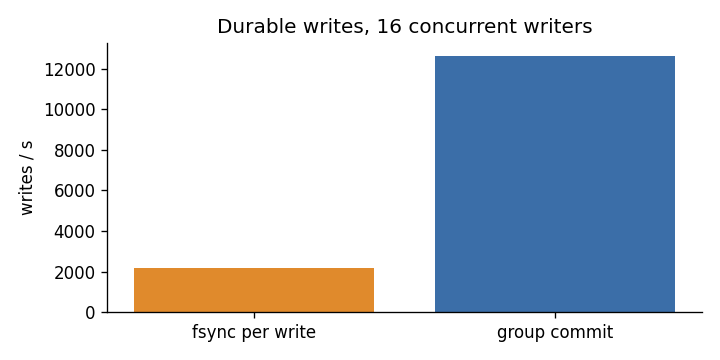
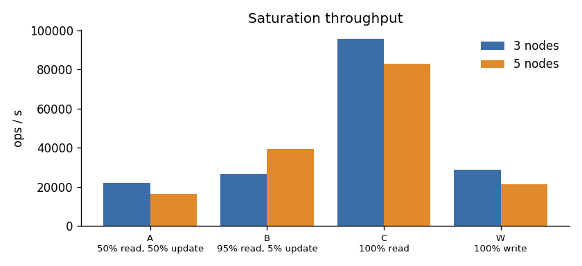
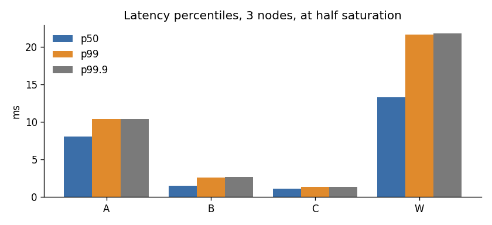
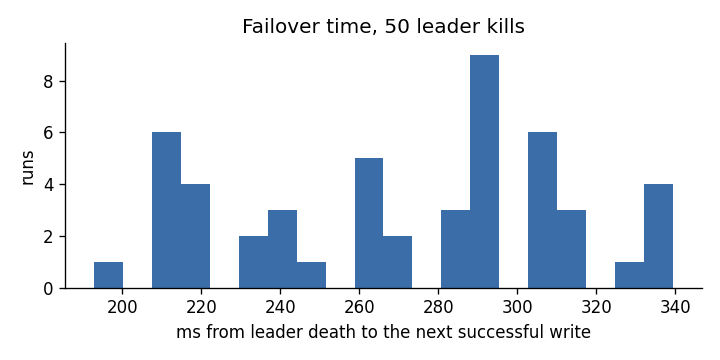

# Benchmark results

Every number here is produced by `bench/run.sh` and rendered by `bench/report.sh`;
nothing is typed in by hand. Raw results are in [`raw/`](raw/).

## Environment

| | |
|---|---|
| date | 2026-10-14T11:30:53Z |
| commit | 14976fd |
| host cpu | Apple M3 |
| host cores | 8 |
| host memory gb | 16 |
| docker cpus | 8 |
| docker memory gb | 7 |
| docker os | Docker Desktop |
| docker kernel | 6.12.76-linuxkit |

All nodes and the load generator share one laptop through Docker Desktop's Linux VM,
competing for the same 8 cores, so absolute numbers are a lower bound for real
hardware with one node per machine, and runs vary by tens of percent. Comparisons
within one run (group commit on/off, ReadIndex vs. log reads) are the meaningful
part. Whether `fsync` inside Docker Desktop's VM reaches the Mac's physical disk was
not verified, so write numbers say more about the code path than about the drive.

## Storage engine alone (no Raft, no network)

16 threads, 1 KB values, in-process.

| Benchmark | ops/s | fsyncs | p50 | p99 | p99.9 |
|---|---:|---:|---:|---:|---:|
| Writes, fsync per write | 2,181 | 43,635 | 7.05 ms | 12.66 ms | 30.77 ms |
| Writes, group commit | 12,627 | 29,577 | 1.16 ms | 4.92 ms | 13.00 ms |
| Writes, no fsync | 75,966 | 0 | 0.15 ms | 0.82 ms | 6.69 ms |
| Random reads | 945,685 | 0 | 0.01 ms | 0.33 ms | 1.17 ms |

**Group commit: 5.8x the write throughput of an fsync per write**, at 8.5 writes per fsync.

## Cluster throughput

YCSB-style workloads, 1 KB values, Zipfian keys (theta 0.99). Saturation:
8 connections with 32 requests in flight each.

| Workload | Mix | 3 nodes ops/s | 5 nodes ops/s |
|---|---|---:|---:|
| A | 50% read, 50% update | 22,199 | 16,490 |
| B | 95% read, 5% update | 26,824 | 39,301 |
| C | 100% read | 95,523 | 82,967 |
| W | 100% write | 28,898 | 21,388 |

Five nodes should be slower than three for anything that touches a quorum, and for
writes they are: every entry is sent to and acknowledged by more followers, on the
same 8 cores. The read-heavy results (B above all) do not follow that pattern
reliably; on a shared machine the 3- vs. 5-node read comparison is within run-to-run
noise and should not be read as 5 nodes being faster.

## Latency

Open-loop at half the saturation throughput, measured from each request's
scheduled send time (no coordinated omission).

| Nodes | Workload | Offered ops/s | p50 | p99 | p99.9 |
|---:|---|---:|---:|---:|---:|
| 3 | A | 11,099 | 8.06 ms | 10.38 ms | 10.43 ms |
| 3 | B | 13,411 | 1.54 ms | 2.63 ms | 2.65 ms |
| 3 | C | 47,761 | 1.09 ms | 1.37 ms | 1.38 ms |
| 3 | W | 14,448 | 13.30 ms | 21.66 ms | 21.82 ms |
| 5 | A | 8,244 | 16.82 ms | 52.00 ms | 53.95 ms |
| 5 | B | 19,650 | 3.07 ms | 4.08 ms | 4.10 ms |
| 5 | C | 41,483 | 1.95 ms | 4.21 ms | 4.53 ms |
| 5 | W | 10,693 | 41.92 ms | 64.83 ms | 65.25 ms |

## Reads: ReadIndex vs. through the log

Workload C (all reads) on 3 nodes. Both are linearizable.

| Read path | ops/s | p50 | p99 |
|---|---:|---:|---:|
| Log entry per read | 42,141 | 5.58 ms | 14.65 ms |
| ReadIndex | 118,095 | 2.00 ms | 3.76 ms |

**ReadIndex: 2.8x the read throughput.**

## Failover

Leader killed with SIGKILL under a steady write stream, 50 times. Failover
time is the longest gap between successful writes: leader death, election timeout
(150-300 ms), election, and the client finding the new leader.

| Runs | p50 | p90 | max |
|---:|---:|---:|---:|
| 50 | 284 ms | 312 ms | 340 ms |

## Recovery

A single node holding 1008 MB on disk, killed with SIGKILL and
restarted: time from spawning the process until it serves a read. That includes
opening the LSM tree, replaying the WAL and the Raft log, and the first election
timeout (150-300 ms), which dominates.

| Runs | median | max |
|---:|---:|---:|
| 5 | 298 ms | 316 ms |

## Bulk load

| Nodes | Keys | Seconds | writes/s |
|---:|---:|---:|---:|
| 3 | 1,000,000 | 32 | 31,016 |
| 5 | 1,000,000 | 49 | 20,373 |

## Correctness under faults

**180 of 180 fault-injection runs linearizable (0 violations), 4,342,771 operations checked with Porcupine.** See `chaos/`.

| Scenario | Runs | Linearizable | Operations |
|---|---:|---:|---:|
| leader-crash | 20 | 20 | 531,207 |
| follower-restart | 20 | 20 | 481,514 |
| minority-partition | 20 | 20 | 463,657 |
| leader-minority | 20 | 20 | 435,379 |
| flapping-partition | 20 | 20 | 312,578 |
| slow-network | 20 | 20 | 325,159 |
| packet-loss | 20 | 20 | 387,237 |
| data-wipe | 20 | 20 | 937,289 |
| clock-skew | 20 | 20 | 468,751 |

